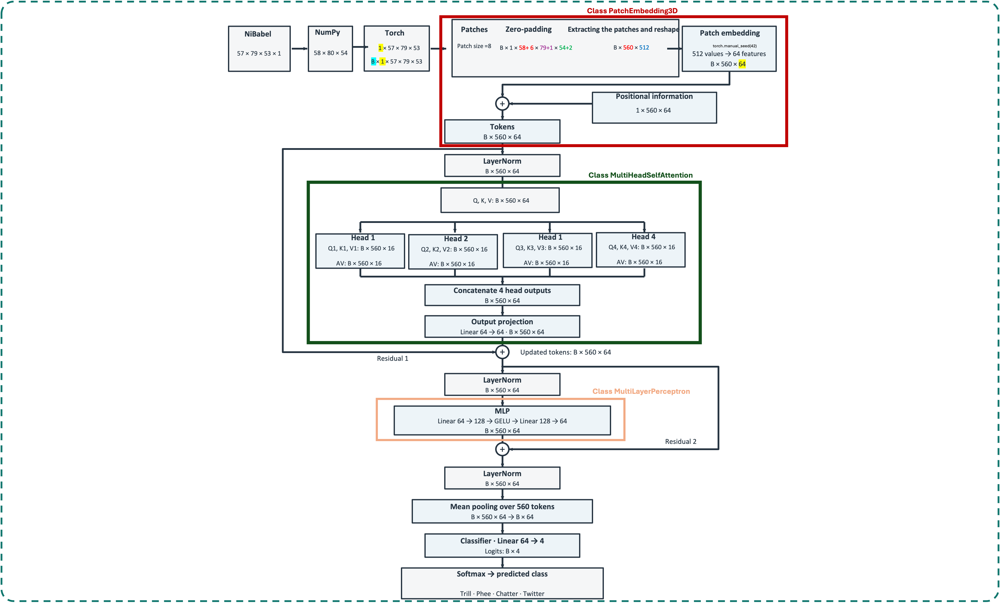

# 3D Vision Transformer for Functional Brain Maps

 

  

 

A from-scratch PyTorch implementation of a 3D Vision Transformer (ViT3D) for four-class classification of functional brain maps associated with **Trill, Phee, Chatter, and Twitter** stimuli.

## Baseline architecture

- Input: one-channel 3D functional map with expected shape (58, 80, 54).
- Patch extraction: non-overlapping 8 × 8 × 8 patches; zero-pad only at high-index edges to make dimensions divisible by 8 (patch size).
- Number of patch patches/tokens: 560
- Patch embedding: 512 voxel values mapped to 64 features.
- Positional embedding: learnable, normal initialization with mean 0 and standard deviation 0.02.
- Transformer blocks: one pre-LayerNorm block with 4 attention heads, 64-dimensional residual stream, MLP hidden dimension 128, GELU, and residual connections.
- Classification: LayerNorm, mean pooling across patch tokens, and a four-logit linear classifier.

## Dataset naming convention

The loader expects names such as:

`m17_s59_r2_cnd2_to_MBM_EventRelatedPhee.nii.gz`

The filename parser extracts subject, session, run, condition, and class. Supported class strings are `Trill`, `Phee`, `Chatter`, and `Twitter`. Place permitted-to-use `.nii` or `.nii.gz` files in a local data directory.
